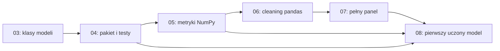

# Jak przebudować kurs dla początkującej osoby

Audyt z 27 października 2026. Stan repozytorium: `951c88c`, gałąź `main`. Dokument proponuje zmiany. Nie zmienia zadań ani nie zawiera ich rozwiązań.

## Najważniejsza decyzja

Rekomenduję zachować projekt Freshcast i standardy inżynierskie, ale zmienić moment, w którym uczestnik musi je samodzielnie realizować. Najpierw powinien zbudować małą, zrozumiałą prognozę i umieć ją ocenić. Następnie przenosi ją do funkcji, testów, klas i pakietu. Dopiero potem rozszerza rozwiązanie na wiele serii i narzędzia produkcyjne.

Obecny kurs jest bliższy intensywnemu kursowi dla osoby, która już swobodnie programuje w Pythonie, niż nauce od zera. [README](../../README.md#dla-kogo) uczciwie wymaga pętli, funkcji, list i słowników. Hasło "od podstaw Pythona" może jednak sugerować inny poziom wejścia. Potrzebne są dwie ścieżki wejścia, zakończone tym samym sprawdzianem podstaw.

Nie da się obiecać, że nikt nigdy nie utknie. Można natomiast zaprojektować kurs tak, aby każda trudność miała rozpoznawalną przyczynę, krótkie ćwiczenie naprawcze i drogę dalszej nauki bez kopiowania całego rozwiązania.

## Co sprawdzono i czego jeszcze nie wiemy

Przejrzałem mapę wszystkich 20 modułów, strukturę wykładów i notebooków, README labów, wymagania zadań, cele w notatkach tutora, słowniczek, standard, ADR oraz mechanizm `check`, zapisu postępu i `catchup`. Szczegółowe porównanie wymagań dotyczy zwłaszcza modułów 00–08 oraz przejść do 09, 13, 15, 18 i 19. Nie otwierałem kodu na gałęzi `solutions` ani nie rozwiązywałem ćwiczeń.

To audyt programu i materiałów, a nie obserwacja zachowania uczestników. W tym checkoutcie nie było `.course/progress.md` ani `.course/progress.json`, więc nie ma podstaw do twierdzeń o rzeczywistych odsetkach rezygnacji lub czasie nauki. Ocena trudności i nowy program są moją rekomendacją, którą trzeba sprawdzić w pilotażu.

Porównanie z innymi kursami opiera się na publicznych stronach organizatorów i syllabusach. Nie oznacza ukończenia płatnych kursów ani oceny wszystkich ich ćwiczeń. Szczegóły, linki i ograniczenia znajdują się w [notatce źródłowej](beginner-course-sources.md). Dane o ocenach, liczbie zapisów i obietnicach zatrudnienia nie są podstawą rekomendacji.

## Co już działa i warto zachować

- Zadania mają konkretne wejścia, wyniki i zachowania błędów. W labach 01–08 układ "Cel, Gdzie, Wejście, Wynik, Skorzystaj z, Kroki, Sprawdzenie" ogranicza zgadywanie.
- Uczestnik pisze kod, zamiast tylko oglądać gotowe notebooki. To dobry fundament kursu praktycznego.
- Sprawdzenia pracują na małych przykładach i podają rozbieżność. Pozwalają oddzielić błąd implementacji od problemu na dużym zbiorze.
- Testy mutacyjne w 04, 05 i 15 pokazują, dlaczego zielony test może niczego nie chronić. Zachowałbym je po krótkim wprowadzeniu do zwykłych testów.
- Leakage, baseline, jawne założenia o danych i ocena na tych samych wierszach przewijają się przez projekt. To ważniejsze niż kolekcjonowanie modeli.
- `small`, lokalne atrapy usług i ścieżka bez tutora ograniczają zależności sprzętowe i usługowe.
- Moduł Shelfwise uczy pracy z cudzym kodem i odtwarzania objawu. To szczególnie wartościowy element przygotowania do pracy.

Kurs ma już też poprawkę kolejności pojęć. [Wykład 03](../../lectures/03-classes/index.html#prognoza) tłumaczy prognozę, horyzont, holdout i MAE przed klasami. [ADR 0001](../adr/0001-concept-before-interface.md) świadomie zachowuje dotychczasowy łańcuch labów. Nie rekomenduję ponownego dodania brakujących definicji. Rekomenduję osobną praktykę przed zadaniem wymagającym kilku nowych abstrakcji naraz.

## Gdzie początkujący może się zatrzymać

| Miejsce i dowód w repozytorium | Co uczestnik musi połączyć | Proponowana zmiana |
|---|---|---|
| [00: setup](../../lectures/00-setup/index.html) | WSL, terminal, fork, środowisko, editor, dane, autoryzacja i pierwszy PR przed pierwszym labem | Oddzielić uruchomienie pierwszej komórki od pełnego workflow GitHub. Dać ćwiczenie terminala i mapę "gdzie wpisuję polecenie". |
| [01: pierwszy lab](../../labs/01-python-data/README.md) | Parsowanie formatu TSF, generator, statystyki popytu, braki, sortowanie po kilku kryteriach, JSON | Przed plikiem przećwiczyć listę kilku liczb i pojedynczy rekord. Generator i ADI odłożyć do rozszerzenia albo osobnej lekcji. |
| [02: funkcje](../../labs/02-functions/README.md) | Migracja kodu, typowanie, `mypy --strict`, domknięcia, fabryka dekoratorów, rejestr, nowe statystyki | Rozdzielić zwykłe funkcje i moduły od zaawansowanych funkcji. Dekoratory pisać po doświadczeniu z testami, najlepiej przy retry. |
| [03: klasy](../../labs/03-classes/README.md) | Stan obiektu, dataclass, walidacja, `property`, `classmethod`, `Self`, ABC, Protocol, StrEnum, modele prognozy | Najpierw jedna zwykła klasa rozwiązująca znany problem. W osobnym kroku dataclass. ABC i Protocol po porównaniu kilku działających modeli. |
| [04: testy i pakiet](../../labs/04-testing/README.md) | Pierwsze własne testy dopiero po trudnych dekoratorach i klasach, do tego pakowanie i drugi manager zależności | Przenieść pierwsze `assert` i `pytest` do prostych funkcji. `uv` zostawić jako narzędzie główne, Poetry jako dodatek. |
| [05: NumPy](../../labs/05-numpy/README.md) | Macierz panelu, broadcasting, maski, cztery metryki i testy mutacyjne | Zacząć od jednej tablicy i ręcznego porównania wyniku. Osobno macierz i osie, potem broadcasting i pełny panel. |
| [06: pandas](../../labs/06-pandas-cleaning/README.md) | Pierwsza ramka od razu prowadzi do wieloarkuszowego cache, ośmiu reguł danych i rozróżniania duplikatów | Dodać lekcję orientacji w tabeli. Pierwszy cleaning lab mały i samodzielny; pełne Online Retail II po podstawach `groupby`. |
| [07: panel](../../labs/07-pandas-panel/README.md) | Wydajny odczyt, downcast, fakty i wymiary, merge, tablice godzinowe, lag, rolling i kontrakty | Podzielić na analizę tabel i czas w panelu. Kolumny godzinowe oraz optymalizację pamięci przenieść do rozszerzenia. |
| [08: pierwszy model uczony](../../labs/08-ml-basics/README.md) | Adapter baseline'u, gradient macierzowy, własny model liniowy, Ridge, scaler, pipeline i selekcja hiperparametru | Najpierw wytrenować gotowy prosty estimator na małych danych. Osobno zrozumieć uczenie od jednej wagi do zapisu macierzowego. |
| [09: cechy](../../labs/09-features/README.md) | Cechy czasowe, target encoding oraz `resolve_order` i zależności między funkcjami | Zacząć od dwóch jawnych funkcji cech. Target encoding i automatyczne porządkowanie zależności przenieść po pierwszym działającym pipeline. |
| [10–11: modele i walidacja](../../labs/10-trees-boosting/README.md) | Drzewo od zera, boosting, interpretacja, prognoza wielokrokowa, potem backtest i tuning | Podstawowy backtest przed wieloma porównaniami modeli. Odseparować mechanikę prognozy wielokrokowej od rodziny estymatorów. |
| [12: klasyfikacja](../../labs/12-classification/README.md) | Od razu przyszła etykieta w panelu, krzywa PR, average precision, koszty i kalibracja | Najpierw ręczna confusion matrix i próg na kilku wynikach. Dopiero potem budowa etykiety czasowej i model. |
| [13: bez nadzoru i sieci](../../labs/13-unsupervised-nn/README.md) | k-means, PCA, ocena segmentów i pierwsza pętla PyTorch | Rozdzielić unsupervised learning od neural networks. Nie uzależniać pierwszego pipeline'u produkcyjnego od obu bloków. |
| [14: pipeline](../../labs/14-pipeline/README.md) | Jednocześnie CLI, konfiguracja, artefakty, logowanie i przygotowanie w porcjach | Najpierw jeden skrypt i zapis wyniku. Następnie konfiguracja i CLI. Przetwarzanie większych danych jako osobny krok. |
| [15: cloud i SQL](../../labs/15-cloud-sql/README.md) | S3, serwer lokalny, retry, cache, atomowa publikacja, testy mutacyjne i pierwszy SQL | SQL przenieść po pandas. Storage zostawić po pipeline, retry wprowadzić na małej funkcji przed klientem S3. |
| [16–17: CI i cudzy kod](../../labs/16-docker-ci/README.md) | Samodzielna konfiguracja narzędzi i nagłe przejście do ticketów | Pierwszy gotowy workflow CI wcześniej. Jeden mały ticket w cudzym pliku po testach; pełny Shelfwise później. |
| [18–19: finał](../../labs/19-capstone/README.md) | Zaliczenie obejmuje GRU z 18 i porównanie sieci z LightGBM | Rozdzielić capstone główny i rozszerzenie neural. Brak GPU nie zamyka ścieżki głównej. |

Szczególnie ważna jest różnica między "pojęcie zostało opisane" a "uczestnik potrafi go użyć". Wykład 02 mówi, że sygnaturę generycznego dekoratora wystarczy rozpoznać i przepisać. To uczciwa pomoc, ale także sygnał, że narzędzie wyprzedza aktualny poziom rozumienia.

### Pierwszy model wymaga już rozbudowanego systemu

Rzeczywisty łańcuch zależności jest spójny technicznie. Pedagogicznie ma wysoki koszt wejścia:

Mała luka w klasach albo budowie panelu może zatrzymać naukę modelowania. `catchup` umożliwia dalsze wykonanie programu, ale nie potwierdza rozumienia poprzednich kroków.

### Sprawdzenie wykonania nie jest sprawdzeniem rozumienia

[Mechanizm sprawdzania](../../src/coursekit/checking.py) rozróżnia poprawny wynik, brak implementacji, niespełniony warunek i wyjątek. Nie sprawdza, czy uczestnik umie wyjaśnić wynik bez kodu. To naturalna granica automatyzacji, którą warto uzupełnić krótkimi pytaniami i nowymi danymi.

Jest też konkretna niespójność informacji o postępie. `check(...)` z notebooka zapisuje wynik, ale terminalowe sprawdzenie zadania notebookowego bez przekazanego obiektu zwraca `todo`. Następnie `record()` zapisuje ten status i zwiększa licznik prób. W efekcie zwykłe wyświetlenie sprawdzeń z terminala może zastąpić wcześniejsze `ok` statusem `todo`. README labów wyjaśniają komunikat "sprawdzasz w notebooku", lecz kursant nadal może odczytać podsumowanie jako utratę zaliczenia. To wniosek z odczytu kodu, nie odtworzony tu testem regresyjnym.

Docelowo potrzebne są osobne informacje: wynik ostatniej rzeczywistej próby, sposób sprawdzania, wykorzystane podpowiedzi i temat do powtórki. Wylistowanie zadania nie powinno liczyć się jako próba rozwiązania.

## Jak korzystać z wzorców innych kursów

Publiczne programy dają wzorce organizacji, nie dowód, że samo skopiowanie kolejności rozwiąże problemy tego kursu.

| Źródło | Co warto przenieść | Granica porównania |
|---|---|---|
| Stanford CS106A | Stopniowanie programowania, rozwiązywanie konkretnych problemów przed bardziej rozbudowaną strukturą programu | Kurs programowania, nie ML engineering. |
| Harvard CS50P | Wyjątki, funkcje i testy jako osobne kroki przed OOP | Inny zakres i model wsparcia uczestnika. |
| Coursera Python for Everybody | Wyraźna ścieżka podstaw Python przed kolejnymi obszarami pracy z danymi | Nie zastępuje docelowego projektu inżynierskiego. |
| Coursera Machine Learning Specialization | Oddzielenie podstaw supervised learning, bardziej zaawansowanych modeli oraz unsupervised learning | ML bez pełnej ścieżki utrzymania pakietu i CI. |
| Udemy: 100 Days of Code oraz Complete Python Bootcamp | Małe projekty, wyraźne sekcje i widoczny wynik kolejnych etapów | Publiczny syllabus nie pozwala ocenić jakości całej informacji zwrotnej. |
| Stanford CS229 i CS230 | Jawne wymagania matematyczne i programistyczne oraz oddzielna ścieżka zaawansowana | To punkt odniesienia dla późniejszych modułów, nie program do skopiowania dla osoby od zera. |

Odnośniki do konkretnych edycji i stron organizatorów są w [porównaniu źródeł](beginner-course-sources.md). Nie rekomenduję przenoszenia wszystkich tematów z żadnego z tych kursów. Freshcast ma pozostać osią nauki.

### Co wspierają badania, a co jest propozycją projektową

IES zaleca rozłożone w czasie powtórki, przeplatanie worked examples z zadaniami, łączenie obrazu z opisem oraz konkretu z abstrakcją. Wskazuje mocne dowody dla odtwarzania wiedzy w quizach i pytań wymagających wyjaśnienia, umiarkowane dla spacing i worked examples. To rekomendacje ogólne, nie badanie skuteczności tego kursu. [IES, Organizing Instruction and Study](https://ies.ed.gov/ncee/wwc/PracticeGuide/1).

Z tego wynika propozycja przejścia od krótkiego omówionego przykładu przez ćwiczenie z częściowym wsparciem do samodzielnego zadania. Przykłady muszą używać innych danych i nie podawać odpowiedzi do zadań ocenianych. Konkretne długości sesji, liczby ćwiczeń i poniższa kolejność są hipotezami do pilotażu, nie liczbami ustalonymi przez badania.

## Proponowana nowa kolejność

Poniższe oznaczenia A–F opisują bloki dydaktyczne, nie nowe numery `course check`. Nie należy od razu renumerować plików. Najpierw trzeba przygotować i sprawdzić ścieżkę nauki.

### A. Wejście i pierwszy samodzielny wynik

1. **Diagnoza podstaw.** Kilka zadań bez nowej biblioteki: prześledzenie pętli, funkcja zwracająca wynik, wybór danych z listy słowników, rozróżnienie zera i braku. Wynik kieruje do konkretnych lekcji, a nie do ogólnej etykiety "za słaby".
2. **Python od zera, jeśli potrzebny.** Zmienne i wartości, wywołania, warunki, pętle, listy, słowniki, funkcje i `return`. Każdy temat z krótkimi zadaniami. Uczestnik znający podstawy pomija ten blok po diagnozie.
3. **Minimalne środowisko.** Otworzenie notebooka, uruchomienie komórki, zapis i ponowne uruchomienie od początku. Oddzielnie wyjaśnione terminal, Python, kernel i katalog roboczy. Przed instalacjami dać możliwość pierwszego eksperymentu w istniejącym runnerze przeglądarkowym.
4. **Dane i mała prognoza.** Jedna seria kilkunastu dni na małym fragmencie danych. Co oznacza obserwacja, braki, historia, data wykonania prognozy i horyzont. Uczestnik oblicza baseline i MAE, potem ogląda prosty wykres historii oraz prognozy.

Rezultat A: uczestnik potrafi powiedzieć, co przewiduje i jak sprawdzi, czy przewidywanie ma sens. Nie potrzebuje jeszcze ABC, Protocol, pełnego panelu ani konta w usłudze AI.

### B. Python potrzebny do samodzielnej pracy z danymi

5. **Kolekcje, pliki i błędy.** Najpierw zwykła pętla, później comprehension. Jeden mały CSV albo uproszczony rekord, następnie pełny plik. `Path`, `with`, konkretne wyjątki, czytanie tracebacka. Generator dopiero po działającym odczycie i wyjaśnieniu zużycia pamięci.
6. **Funkcje i pierwsze testy.** Argument, wynik, lokalna zmienna, efekt uboczny, mutowalność. Ręczny przykład oczekiwanego wyniku, `assert`, jeden test pytest, przypadek brzegowy. Funkcję najpierw uruchamiamy, potem porządkujemy.
7. **Moduł, git i podstawowa jakość.** Przeniesienie jednej działającej funkcji do pliku, import i ponowny import w notebooku. Typy podstawowe, ruff, własny mały test. Pierwszy branch, commit i PR dopiero na kodzie, którego sens uczestnik rozumie. Pokazany gotowy workflow CI.

Rezultat B: mały moduł z testem i odtwarzalnym wynikiem. Pełne `mypy --strict` dla zaawansowanych generyków pozostaje późniejszym wymaganiem.

### C. Tabele, tablice i pierwszy uczony model

8. **pandas od pojedynczej tabeli.** Jeden wiersz, kolumna, indeks, typ, `.loc`, maska, nowa kolumna. Zanim pojawi się cleaning pipeline, uczestnik odpowiada na kilka pytań o dane i czyta wykres.
9. **NumPy potrzebne do obliczeń.** Tablica jednowymiarowa, elementowe operacje, maski, braki, shape. Potem dwie osie, redukcja i broadcasting. Wersja MAE porównana z wcześniejszym liczeniem ręcznym. Macierz wszystkich serii jest zadaniem późniejszym.
10. **Czyszczenie, agregacje i relacje.** Mała ramka, jawny klucz, proste `groupby().agg`, następnie `transform`, złączenie i sprawdzenie liczby wierszy. Dopiero potem trudne duplikaty z Online Retail II, cache i kontrakt pliku.
11. **Czas i cechy na małym panelu.** Jedna seria, potem dwie celowo różne. Sortowanie, brakujący dzień, lag i rolling. Na osi czasu zaznaczone, co wiadomo w chwili prognozy. Horyzont jednego dnia przed prognozą całego tygodnia.
12. **Pierwszy model ze scikit-learn.** Co oznaczają `X`, `y`, `fit`, `predict`; podział po czasie i baseline. Prosty model liniowy lub małe drzewo, gotowy estimator, kilka jawnych cech. Najpierw model i uczciwa ocena, potem scaler z `Pipeline` i porównanie wyników.

Rezultat C: mały projekt od danych do porównania baseline'u z modelem. Pełne API Freshcast nie jest warunkiem pierwszego uczenia. Dane demonstracyjne są częścią kursu, a kod ocenianego rozwiązania nadal pisze uczestnik.

### D. Zrozumienie modeli i oceny

13. **Matematyka modelu liniowego.** Średnia, wariancja i skala poznane wcześniej na danych. Teraz prosta z jedną wagą, strata dla kilku wartości wagi, nachylenie i krok uczenia. Potem dwie cechy, iloczyn skalarny, macierz i gradient. Własny gradient descent jako osobny lab po pierwszym estimatorze.
14. **Walidacja i porównanie.** Underfitting, overfitting, train i validation, kilka przesuwanych okien. MAE, RMSE, WAPE i bias wraz z ograniczeniami. Najpierw tabela wyników ręcznie wybranych ustawień, dopiero później automatyczne strojenie.
15. **Cechy, drzewa i boosting.** Kalendarz, proste kodowanie kategorii, regresyjne drzewo, las, boosting. Jedno porównanie zmienia jedną rzecz. Direct i recursive forecasting jako osobny odcinek z osią dostępności danych. Target encoding, SHAP i graf zależności cech jako rozszerzenia po podstawach.
16. **Klasyfikacja jako drugi rodzaj celu.** Kilka ręcznie ocenionych alarmów, confusion matrix, precision i recall, próg i koszt. Potem własna etykieta przyszłego dnia i model. Kalibracja po rozróżnieniu rankingu i prawdopodobieństwa.

Rezultat D: uczestnik umie wybrać model i uzasadnić ocenę. Nie musi jeszcze samodzielnie implementować każdej rodziny algorytmów ani używać PyTorch.

### E. Inżynieria na działającym przykładzie

17. **Klasy, interfejs i pakiet.** Działający model pokazuje potrzebę przechowywania stanu. Zwykła klasa, konstruktor, metoda, potem dataclass. Kilka modeli daje powód wspólnej umowie. Wybrać najpierw jeden sposób jej opisania; porównanie ABC i Protocol zostawić na później. Tu zaostrzyć typowanie i dokończyć przenoszenie do pakietu.
18. **Pipeline i odtwarzalność.** Najpierw skrypt, który uruchamia istniejące kroki. Potem CLI, konfiguracja, logi, zapis modelu i metadane eksperymentu. MLflow po prostym dzienniku wyników. Rejestr cech dopiero wtedy, gdy jawna lista kroków zaczyna przeszkadzać.
19. **SQL i przechowywanie danych.** SQL można przejść już po punkcie 10 jako osobną gałąź. Po pipeline następują lokalne storage i publikacja. Przy retry wracają funkcje jako wartości, prosty wrapper i dopiero fabryka dekoratorów. Lokalny serwer wystarcza do zaliczenia.
20. **CI, kontener i praca z cudzym kodem.** Uczestnik wcześniej korzystał z gotowego CI, teraz pisze własne. Docker po działającym lokalnie CLI. Jeden ticket Shelfwise z prowadzeniem, kolejne samodzielnie.
21. **Capstone główny.** Baseline oraz model tabelaryczny, wspólny backtest, zamknięty test, odtwarzalny pipeline, testy, CI i raport. Wniosek o braku poprawy jest dopuszczalny, jeśli badanie jest poprawne i pokazuje ograniczenia.

### F. Rozszerzenia po pierwszym ukończonym projekcie

- **Unsupervised learning.** Profile serii, skalowanie, odległość, k-means i interpretacja. PCA w osobnej lekcji. Wynik nie musi być cechą modelu prognozującego.
- **Neural networks na CPU.** Tensor, autograd, MLP, batch, pętla treningowa i walidacja. Najpierw dane syntetyczne, potem Freshcast.
- **Sequence models i GPU.** Okna czasowe, Dataset, embeddings, GRU. Następnie urządzenie i pamięć. Mixed precision i Lightning dopiero po działającej zwykłej pętli.
- **Zaawansowany forecasting i infrastruktura.** Target encoding, korekta popytu ocenzurowanego, przetwarzanie dużych danych, pełny storage oraz dodatkowe porównania modeli.

Rozszerzenia zachowują ambicję obecnego programu. Ich ukończenie może mieć osobny capstone. Nie są warunkiem zaliczenia głównej ścieżki ML engineering.

## Co zrobić z każdym obecnym modułem

| Obecny moduł | Los materiału |
|---|---|
| 00 | Podzielić na minimalne uruchomienie, obsługę środowiska oraz workflow GitHub. NVIDIA dopiero przed rozszerzeniem GPU. |
| 01 | Zachować większość, poprzedzić diagnostyką i podstawami. ADI oraz TSF po prostym odczycie. |
| 02 | Funkcje, importy i podstawowe typy wcześnie. Closures, dekoratory i typy generyczne rozłożyć na późniejsze potrzeby. |
| 03 | Prognozę przenieść wcześniej. Zwykłe klasy po pierwszym modelu, interfejsy w bloku inżynierskim. |
| 04 | Proste testy wcześniej. Pakiet po działającym małym projekcie. Poetry opcjonalnie. |
| 05 | Podzielić na podstawy tablic i zaawansowany panel. Metryki wprowadzać w miarę potrzeb, zaczynając od MAE. |
| 06 | Dodać podstawy pandas. Duży cleaning lab rozdzielić na samodzielne odcinki. |
| 07 | Oddzielić relacje od operacji czasowych. Godziny i pamięć jako drugi przebieg. |
| 08 | Rozdzielić użycie estymatora, uczciwą ocenę, matematykę uczenia i adapter do Freshcast. |
| 09 | Proste cechy w rdzeniu. Target encoding i graf zależności później. |
| 10 | Drzewa i boosting w rdzeniu. SHAP i forecasting wielokrokowy osobno. |
| 11 | Podstawowy backtest wcześniej. Optuna i MLflow po ręcznych eksperymentach. |
| 12 | Zachować jako kolejny rodzaj zadania po regresji i podstawach walidacji. Rozdzielić metryki od budowy etykiety. |
| 13 | Rozdzielić unsupervised learning, PCA i neural networks. Umieścić w rozszerzeniach. |
| 14 | Szkic pipeline'u wcześniej; pełny CLI i konfiguracja po klasach i pakiecie. |
| 15 | SQL po podstawach tabel. Storage po pipeline, niezależnie od SQL. |
| 16 | Gotowe CI przy pierwszym PR. Własne CI i Docker po działającym CLI. |
| 17 | Małe czytanie cudzego kodu wcześniej. Pełny Shelfwise blisko końca rdzenia. |
| 18 | Oddzielna ścieżka po podstawach PyTorch. GPU nie jest wymaganiem wejścia do rdzenia. |
| 19 | Dwa warianty capstone. Ocena metody i dowodów, nie wymuszenie zwycięskiego wyniku. |

## Jak przepisać treść lekcji i zadań

### Jedna lekcja kończy się jedną nową umiejętnością

Obecne moduły mogą pozostać rozdziałami, ale w ich wnętrzu potrzebne są krótsze lekcje. Startowa hipoteza to sesje około 30–60 minut, zawierające wyjaśnienie i praktykę. Nie należy dzielić według samej długości tekstu. Granicą jest rzecz, którą uczestnik potrafi samodzielnie zrobić.

Proponowany układ pojedynczej lekcji:

1. Pokazujemy problem, wejście i oczekiwany wynik. Uczestnik rozumie sens zadania, zanim pozna nowe API.
2. Sprawdzamy dwie lub trzy potrzebne umiejętności. Brak kieruje do konkretnego krótkiego materiału.
3. Omawiamy mały przykład na innych danych niż zadanie oceniane. Każda nowa operacja ma widoczny rezultat.
4. Uczestnik przewiduje wynik albo uzupełnia brakujący krok. Wyjaśnia, dlaczego tak uważa.
5. Rozwiązuje zadanie samodzielnie na nowych danych. Check bada zachowanie, a krótkie pytanie sprawdza rozumienie.
6. Wraca jedno pytanie z wcześniejszej lekcji. Na końcu zapisuje, co potrafi oraz co jeszcze wymaga powtórki.

Podpowiedzi i przykłady nadal nie piszą rozwiązania za uczestnika. Zmieniamy dostępność nauczania przed utknięciem. Worked example nie powinien pojawiać się dopiero po trzecim nieudanym podejściu do nowego pojęcia.

### Rozdzielić pojęcie, bibliotekę i jakość kodu

Przy `rolling` pierwsza próba dotyczy ręcznego wyniku i osi czasu. Druga dotyczy pandas. Trzecia dodaje walidację i test. Dopiero końcowe zadanie łączy wszystkie warstwy.

Ta sama zasada dotyczy modelu liniowego. Najpierw przewidywanie z jednej wagi, potem uczenie i ocena, dalej tablice, na końcu interfejs własnego modelu. Uczestnik nie powinien jednocześnie debugować matematyki, mypy i brakującego importu.

Typy i testy nie znikają. Wcześnie dajemy proste sygnatury i pojedynczy test. Wymagania K1, K9 i T1 z [obecnego standardu](../standard.md) włączamy etapami zgodnie z nowym programem. Kryteria końcowego projektu pozostają wymagające. Zmiana wymaga też aktualizacji kolumny "Od", instrukcji review i zakresów uruchamianych sprawdzeń.

### Dodać matematykę wtedy, gdy ma zastosowanie

Brakuje wydzielonej ścieżki ćwiczeń łączącej deklarowane podstawy szkolne z gradientem macierzowym. Samo podanie wzoru i objaśnienie `X.T` w wykładzie 08 nie mówi, czy uczestnik umie z niego skorzystać.

| Przed czym | Krótkie przygotowanie | Dowód gotowości |
|---|---|---|
| ADI i CV² | Udział, średnia, wariancja oraz różnica zera i braku | Obliczenie statystyk kilku obserwacji i opis jednostek |
| NumPy i scaler | Wektor, tabela liczb, shape, osie, odchylenie standardowe | Przewidzenie kształtu wyniku i ręczna standaryzacja jednej wartości |
| Model liniowy | Wykres prostej, waga, intercept i błąd | Ręczne obliczenie prognozy i wpływu zmiany wagi |
| Gradient descent | Strata jako funkcja wagi, nachylenie i wielkość kroku | Wybór kierunku kroku na rysunku, potem wynik liczbowy |
| Klasyfikacja | Częstość zdarzenia, proporcja i koszt decyzji | Porównanie dwóch progów na małej confusion matrix |
| PCA i sieci | Rzutowanie lub pochodna złożenia, zależnie od ścieżki | Osobne ćwiczenie przed użyciem biblioteki |

Nie dodawałbym na początku obowiązkowego wielkiego kursu matematyki. Przygotowanie ma odpowiadać zadaniu i zawierać praktykę, nie sam link do zewnętrznego wykładu.

### Mniej zmiany kontekstu, więcej samodzielnego sprawdzania

Car Parts i Online Retail II mają uzasadnienie, a drugi zbiór wraca w Shelfwise. Nie usuwałbym ich automatycznie. Rdzeń prowadziłbym jednak po jednym małym wycinku FreshRetailNet. Inne dane służą sprawdzeniu przenoszenia umiejętności, a nie każdorazowemu uczeniu nowej domeny, formatu i biblioteki jednocześnie.

Na początku każdej lekcji potrzebny jest schemat miejsca pracy: czytam wykład, edytuję notebook albo konkretny plik, uruchamiam wskazane sprawdzenie. Warto dodać osobne materiały o kolejności wykonania komórek, restartowaniu kernela, autoreload, tracebacku i różnicy między błędem środowiska a błędem rozwiązania.

Instrukcje mają umożliwiać taki sam postęp bez płatnego tutora. Pytania bez automatycznej oceny potrzebują krótkiej rubryki samooceny i przykładu poprawnego uzasadnienia na innym problemie. Samo "porozmawiaj z tutorem" nie wystarcza jako jedyna informacja zwrotna.

### Doprecyzować dwa komunikaty o wynikach

Wykład 08 mówi, że model niebijący baseline'u niczego się nie nauczył. Zastąpiłbym to stwierdzeniem, że model nie wykazał użytecznej poprawy w tym porównaniu. Słaby wynik nie rozstrzyga sam, czy przyczyną są cechy, dane, ograniczenia modelu czy implementacja.

Capstone wymaga pobicia baseline'u także na końcowym tygodniu testowym. Ten warunek może zachęcić do ponawiania oceny i dopasowania do testu. Zaliczenie powinno wymagać poprawnej metody, zamrożonych decyzji i uczciwego raportu. Nieudany eksperyment z poprawnymi dowodami jest wartościowym wynikiem nauki.

Dodatkowo należy wyraźnie nazwać testy ćwiczeniowe oraz końcowy zbiór capstone. Lab 08 odkłada końcówkę danych treningowych, a 19 korzysta z `eval.parquet`, więc samo zajrzenie do testu w 08 nie dowodzi naruszenia końcowego holdoutu. Potrzebna jest mapa: które dane służą nauce, które walidacji, a które pozostają zamknięte do finału.

## Jak umożliwić dalszą naukę bez ukrywania braków

### Trzy rodzaje trudności dostają różne odpowiedzi

| Trudność | Rozpoznanie | Droga powrotu |
|---|---|---|
| Środowisko | Notebook lub import nie uruchamia się przed próbą rozwiązania | Oddzielny doctor, instrukcja naprawy i mały test środowiska |
| Brak podstaw | Uczestnik nie potrafi ręcznie przewidzieć wyniku na kilku danych | Krótka lekcja pojęcia i dwa nowe mikroćwiczenia |
| Błąd implementacji | Ręczny wynik jest poprawny, kod daje inny | Minimalne dane, traceback, wskazanie warstwy błędu i kolejny poziom podpowiedzi |

Tutor już stosuje część tego rozróżnienia. Należy udostępnić je także osobie uczącej się bez AI.

### Zależność od wcześniejszego labu nie może być jedyną drogą

Dla dużych etapów danych kurs powinien dostarczać mały, wersjonowany zbiór wejściowy, zgodny z kontraktem następnej lekcji. Uczestnik wybiera własny wynik poprzedniego etapu albo dane startowe. W drugim przypadku wcześniejsze zadanie pozostaje niezaliczone, ale można ćwiczyć nową umiejętność.

To inne narzędzie niż istniejący [catchup](../../src/coursekit/catchup.py), który przepisuje wcześniejsze pliki kodem referencyjnym i wykonuje backup. Dostarczony plik danych nie zastępuje funkcji uczestnika. Pozwala oddzielić "chcę dziś uczyć się modelu" od "muszę najpierw naprawić cache".

Dla zależności programistycznych można udostępnić jawny, gotowy komponent kursowy z małą publiczną umową. Uczestnik nie edytuje go i nie dostaje za niego zaliczenia. W późniejszej lekcji zastępuje komponent własną implementacją.

### Zaliczenia nie muszą blokować całego kursu

Warunkiem przejścia są umiejętności niezbędne do następnego zadania, nie wszystkie dodatki bieżącego modułu. Słabe rozumienie dat i dostępności informacji wymaga poprawy przed forecastingiem. Brak własnego target encodera nie musi blokować drzew, a nieukończony PyTorch nie musi blokować pipeline'u.

Przy każdym punkcie kontrolnym potrzebne są dwa krótkie zadania na nowych danych: jedno przewidywanie wyniku i jedno wyjaśnienie błędu. Zachowujemy istniejące review kodu. Dodajemy dowód, że uczestnik potrafi użyć poznanej umiejętności poza konkretnym checkiem.

## Plan wdrożenia

### Etap 1. Zmniejszyć obecne bariery bez zmiany numeracji

1. Uzgodnić opis odbiorcy i dodać diagnozę wejścia wraz z uzupełnieniem podstaw Python.
2. Dodać miniścieżkę prognoza → MAE → wykres przed klasami. Nie wystarczy kolejna definicja we wstępie 03.
3. Dodać proste testy funkcji przed dekoratorami i pierwszą lekcję orientacji w pandas przed cleaning pipeline.
4. Przygotować małe wejścia do etapów 07, 08 i 14 oraz opisać, jak wrócić do własnego pipeline'u.
5. Rozdzielić status notebooka od terminalowego listowania. Uzgodnić raport postępu między CLI, notebookiem i przeglądarką.
6. Zmienić capstone tak, aby rdzeń dało się ukończyć bez GRU i GPU oraz bez wymuszonego zwycięstwa na teście.
7. Usunąć rozbieżność README "gotowe 00, 07 i fragment 01" z faktyczną obecnością materiałów. Zamiast domyślać się kompletności, nadać modułom jawne statusy: szkic, gotowy redakcyjnie, zweryfikowany technicznie, sprawdzony z uczestnikami.

Etap 1 ogranicza tarcie, ale pozostawia przeciążenie modułów 02–03. Nie traktowałbym go jako docelowej przebudowy.

### Etap 2. Sprawdzić nowy początek na uczestnikach

Przygotować bloki A–C na wydzielonej ścieżce materiałów. Dwie grupy wejścia: osoby od zera oraz osoby umiejące już napisać prostą funkcję i pętlę. Wystarczy zacząć od małego pilotażu jakościowego, na przykład kilku osób o różnym poziomie. Nie będzie to dowód statystyczny skuteczności.

Zapisywać, za zgodą uczestników: czas do pierwszego samodzielnego wyniku, miejsce przerwania, rodzaj pomocy, wykonane zadania naprawcze oraz wynik nowego zadania po przerwie. Rozmowa o tym, co uczestnik myślał, jest równie ważna jak czerwony check. Sam licznik `attempts` nie wystarcza.

### Etap 3. Przebudować zależności i dopiero potem numery

Po pilotażu rozdzielić obecne 02, 03, 07, 08, 13 i 15. Zmienić mapę wymagań, standard, tutor notes i rubryki review. Na końcu zmieniać task IDs, `course check`, `catchup`, bookmarki wykładów i odnośniki w notebookach. Przygotować migrację postępu oraz kopię starych notatek uczestnika.

Nowy ADR powinien zastąpić ograniczenie "lab order stays fixed" z ADR 0001, opisując koszt migracji oraz wynik pilotażu. Koszt zachowania działającego łańcucha jest realny, ale nie powinien sam wyznaczać kolejności nauki nowej edycji.

### Jak ocenić, czy zmiana pomogła

| Pytanie | Co mierzyć | Jak nie pomylić wyniku |
|---|---|---|
| Czy start jest dostępniejszy? | Czas do samodzielnej małej prognozy, błędy środowiska, miejsca rezygnacji | Osobno dla osób od zera i ze znajomością podstaw |
| Czy uczestnik rozumie? | Nowe dane, ręczne przewidywanie wyniku i krótkie uzasadnienie | Zielony check i odtworzenie przykładu nie wystarczają |
| Czy wiedza zostaje? | Krótka próba po kilku dniach i po dalszym module | Rozdzielić wynik bez pomocy od wyniku z podpowiedzią |
| Czy pomoc odblokowuje? | Powrót do samodzielnego zadania po ćwiczeniu naprawczym | Samo przejście dalej przez catchup nie oznacza zrozumienia |
| Czy standard końcowy się utrzymał? | Porównywalne review capstone, leakage, testy, odtwarzalność i jakość wniosków | Porównywać ten sam rdzeń, osobno rozszerzenia |

Nie podaję nowej obietnicy liczby godzin. Obecne około 160 godzin nie zostało tu zweryfikowane z początkującymi. Pełne podstawy Python i utrwalanie zwiększą czas dla części osób. Uczciwe oszacowanie powinno pokazać osobno przygotowanie, rdzeń i rozszerzenia oraz opierać się na pilotażu.

## Od czego zacząłbym

Pierwszy konkretny fragment do przebudowy to droga od wejścia do pierwszej małej prognozy i jej testu. Następnie funkcje, proste pytest i tabela pandas. Dopiero po sprawdzeniu tego początku przesuwałbym klasy, zmieniał API pakietu i renumerował resztę kursu.

Największa oczekiwana korzyść to możliwość rozumienia i samodzielnego działania przed opanowaniem całej infrastruktury projektu. Końcowy poziom techniczny można zachować, rozkładając naukę na więcej sprawdzalnych kroków.
