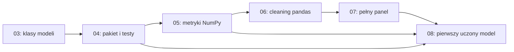

# Jak przebudować kurs dla początkującej osoby

Audyt z 27 października 2026, zaktualizowany po zmianie nacisku na rozumienie ML/AI oraz kontroli zależności z `gpt-6-astra`. Stan analizowanego repozytorium: `951c88c`, gałąź `main`. Dokument proponuje zmiany. Nie zmienia zadań ani nie zawiera ich rozwiązań.

## Najważniejsza decyzja

Rekomenduję zachować projekt Freshcast oraz podstawy jakości kodu, ale zmienić moment, w którym uczestnik musi je samodzielnie realizować. Najpierw powinien zbudować małą, zrozumiałą prognozę i umieć ją ocenić. Następnie porządkuje rozwiązanie w funkcje, testy i prosty moduł. Po zdobyciu tych kompetencji przechodzi do głębszego rozumienia uczenia, niepewności, reprezentacji i szerszych metod AI.

Usuwam z rdzenia wcześniejsze punkty propozycji: 18 "Pipeline i odtwarzalność", 20 "CI, kontener i praca z cudzym kodem" oraz 21 "Capstone główny". Ich miejsce zajmuje blok pojęciowy opisany poniżej. SQL z wcześniejszego punktu 19 może pozostać dodatkiem po tabelach; storage trafia do opcjonalnej ścieżki inżynierskiej. Odtwarzalny eksperyment i uczciwa walidacja nadal są potrzebne, ale nie wymagają osobnego projektu produkcyjnego.

Obecny kurs jest bliższy intensywnemu kursowi dla osoby, która już swobodnie programuje w Pythonie, niż nauce od zera. [README](../../README.md#dla-kogo) uczciwie wymaga pętli, funkcji, list i słowników. Hasło "od podstaw Pythona" może jednak sugerować inny poziom wejścia. Potrzebne są dwie ścieżki wejścia, zakończone tym samym sprawdzianem podstaw.

Nie da się obiecać, że nikt nigdy nie utknie. Można natomiast zaprojektować kurs tak, aby każda trudność miała rozpoznawalną przyczynę, krótkie ćwiczenie naprawcze i drogę dalszej nauki bez kopiowania całego rozwiązania.

## Co sprawdzono i czego jeszcze nie wiemy

Przejrzałem mapę wszystkich 20 modułów, strukturę wykładów i notebooków, README labów, wymagania zadań, cele w notatkach tutora, słowniczek, standard, ADR oraz mechanizm `check`, zapisu postępu i `catchup`. Szczegółowe porównanie wymagań dotyczy zwłaszcza modułów 00–08 oraz przejść do 09, 13, 15, 18 i 19. Nie otwierałem kodu na gałęzi `solutions` ani nie rozwiązywałem ćwiczeń.

To audyt programu i materiałów, a nie obserwacja zachowania uczestników. W tym checkoutcie nie było `.course/progress.md` ani `.course/progress.json`, więc nie ma podstaw do twierdzeń o rzeczywistych odsetkach rezygnacji lub czasie nauki. Ocena trudności i nowy program są moją rekomendacją, którą trzeba sprawdzić w pilotażu.

Porównanie z innymi kursami opiera się na publicznych stronach organizatorów i syllabusach. Nie oznacza ukończenia płatnych kursów ani oceny wszystkich ich ćwiczeń. Szczegóły, linki i ograniczenia znajdują się w [notatce źródłowej](beginner-course-sources.md). Dane o ocenach, liczbie zapisów i obietnicach zatrudnienia nie są podstawą rekomendacji.

## Co już działa i warto zachować

- Zadania mają konkretne wejścia, wyniki i zachowania błędów. W labach 01–08 układ "Cel, Gdzie, Wejście, Wynik, Skorzystaj z, Kroki, Sprawdzenie" ogranicza zgadywanie.
- Uczestnik pisze kod, zamiast tylko oglądać gotowe notebooki. To dobry fundament kursu praktycznego.
- Sprawdzenia pracują na małych przykładach i podają rozbieżność. Pozwalają oddzielić błąd implementacji od problemu na dużym zbiorze.
- Testy mutacyjne w 04, 05 i 15 pokazują, dlaczego zielony test może niczego nie chronić. Zachowałbym je po krótkim wprowadzeniu do zwykłych testów.
- Leakage, baseline, jawne założenia o danych i ocena na tych samych wierszach przewijają się przez projekt. To ważniejsze niż kolekcjonowanie modeli.
- `small`, lokalne atrapy usług i ścieżka bez tutora ograniczają zależności sprzętowe i usługowe.
- Moduł Shelfwise uczy pracy z cudzym kodem i odtwarzania objawu. Warto zachować go jako opcjonalny materiał dla osób wybierających dalszą ścieżkę inżynierską.

Kurs ma już też poprawkę kolejności pojęć. [Wykład 03](../../lectures/03-classes/index.html#prognoza) tłumaczy prognozę, horyzont, holdout i MAE przed klasami. [ADR 0001](../adr/0001-concept-before-interface.md) świadomie zachowuje dotychczasowy łańcuch labów. Nie rekomenduję ponownego dodania brakujących definicji. Rekomenduję osobną praktykę przed zadaniem wymagającym kilku nowych abstrakcji naraz.

## Gdzie początkujący może się zatrzymać

| Miejsce i dowód w repozytorium | Co uczestnik musi połączyć | Proponowana zmiana |
|---|---|---|
| [00: setup](../../lectures/00-setup/index.html) | WSL, terminal, fork, środowisko, editor, dane, autoryzacja i pierwszy PR przed pierwszym labem | Oddzielić uruchomienie pierwszej komórki od pełnego workflow GitHub. Dać ćwiczenie terminala i mapę "gdzie wpisuję polecenie". |
| [01: pierwszy lab](../../labs/01-python-data/README.md) | Parsowanie formatu TSF, generator, statystyki popytu, braki, sortowanie po kilku kryteriach, JSON | Przed plikiem przećwiczyć listę kilku liczb i pojedynczy rekord. Generator i ADI odłożyć do rozszerzenia albo osobnej lekcji. |
| [02: funkcje](../../labs/02-functions/README.md) | Migracja kodu, typowanie, `mypy --strict`, domknięcia, fabryka dekoratorów, rejestr, nowe statystyki | Rozdzielić zwykłe funkcje i moduły od zaawansowanych funkcji. Dekoratory pisać po doświadczeniu z testami, najlepiej przy retry. |
| [03: klasy](../../labs/03-classes/README.md) | Stan obiektu, dataclass, walidacja, `property`, `classmethod`, `Self`, ABC, Protocol, StrEnum, modele prognozy | Najpierw jedna zwykła klasa rozwiązująca znany problem. W osobnym kroku dataclass. ABC i Protocol po porównaniu kilku działających modeli. |
| [04: testy i pakiet](../../labs/04-testing/README.md) | Pierwsze własne testy dopiero po trudnych dekoratorach i klasach, do tego pakowanie i drugi manager zależności | Przenieść pierwsze `assert` i `pytest` do prostych funkcji. `uv` zostawić jako narzędzie główne, Poetry jako dodatek. |
| [05: NumPy](../../labs/05-numpy/README.md) | Macierz panelu, broadcasting, maski, cztery metryki i testy mutacyjne | Zacząć od jednej tablicy i ręcznego porównania wyniku. Osobno macierz i osie, potem broadcasting i pełny panel. |
| [06: pandas](../../labs/06-pandas-cleaning/README.md) | Pierwsza ramka od razu prowadzi do wieloarkuszowego cache, ośmiu reguł danych i rozróżniania duplikatów | Dodać lekcję orientacji w tabeli. Pierwszy cleaning lab mały i samodzielny; pełne Online Retail II po podstawach `groupby`. |
| [07: panel](../../labs/07-pandas-panel/README.md) | Wydajny odczyt, downcast, fakty i wymiary, merge, tablice godzinowe, lag, rolling i kontrakty | Podzielić na analizę tabel i czas w panelu. Kolumny godzinowe oraz optymalizację pamięci przenieść do rozszerzenia. |
| [08: pierwszy model uczony](../../labs/08-ml-basics/README.md) | Adapter baseline'u, gradient macierzowy, własny model liniowy, Ridge, scaler, pipeline i selekcja hiperparametru | Najpierw wytrenować gotowy prosty estimator na małych danych. Osobno zrozumieć uczenie od jednej wagi do zapisu macierzowego. |
| [09: cechy](../../labs/09-features/README.md) | Cechy czasowe, target encoding oraz `resolve_order` i zależności między funkcjami | Zacząć od dwóch jawnych funkcji cech. Target encoding i automatyczne porządkowanie zależności przenieść do rozszerzenia. |
| [10–11: modele i walidacja](../../labs/10-trees-boosting/README.md) | Drzewo od zera, boosting, interpretacja, prognoza wielokrokowa, potem backtest i tuning | Podstawowy backtest przed wieloma porównaniami modeli. Odseparować mechanikę prognozy wielokrokowej od rodziny estymatorów. |
| [12: klasyfikacja](../../labs/12-classification/README.md) | Od razu przyszła etykieta w panelu, krzywa PR, average precision, koszty i kalibracja | Najpierw ręczna confusion matrix i próg na kilku wynikach. Dopiero potem budowa etykiety czasowej i model. |
| [13: bez nadzoru i sieci](../../labs/13-unsupervised-nn/README.md) | k-means, PCA, ocena segmentów i pierwsza pętla PyTorch | Rozdzielić na lekcje o reprezentacjach, unsupervised learning i sieciach. Podstawy pojęciowe w rdzeniu, rozbudowany training loop w rozszerzeniu. |
| [14: pipeline](../../labs/14-pipeline/README.md) | Jednocześnie CLI, konfiguracja, artefakty, logowanie i przygotowanie w porcjach | Przenieść pełny moduł do ścieżki opcjonalnej. W rdzeniu wystarczy eksperyment uruchamiany od początku i zapis wyniku. |
| [15: cloud i SQL](../../labs/15-cloud-sql/README.md) | S3, serwer lokalny, retry, cache, atomowa publikacja, testy mutacyjne i pierwszy SQL | SQL jako dodatek po pandas. Storage i retry w opcjonalnej ścieżce inżynierskiej. |
| [16–17: CI i cudzy kod](../../labs/16-docker-ci/README.md) | Samodzielna konfiguracja narzędzi i nagłe przejście do ticketów | Gotowy workflow może wspierać ćwiczenia. Samodzielny Docker, CI i Shelfwise poza rdzeniem. |
| [18–19: finał](../../labs/19-capstone/README.md) | Zaliczenie obejmuje GRU z 18 i porównanie sieci z LightGBM | Pełny GRU i capstone produkcyjny jako rozszerzenia. Finał rdzenia sprawdza rozumienie na małych eksperymentach. |

Szczególnie ważna jest różnica między "pojęcie zostało opisane" a "uczestnik potrafi go użyć". Wykład 02 mówi, że sygnaturę generycznego dekoratora wystarczy rozpoznać i przepisać. To uczciwa pomoc, ale także sygnał, że narzędzie wyprzedza aktualny poziom rozumienia.

### Pierwszy model wymaga już rozbudowanego systemu

Rzeczywisty łańcuch zależności jest spójny technicznie. Pedagogicznie ma wysoki koszt wejścia:

Mała luka w klasach albo budowie panelu może zatrzymać naukę modelowania. `catchup` umożliwia dalsze wykonanie programu, ale nie potwierdza rozumienia poprzednich kroków.

### Sprawdzenie wykonania nie jest sprawdzeniem rozumienia

[Mechanizm sprawdzania](../../src/coursekit/checking.py) rozróżnia poprawny wynik, brak implementacji, niespełniony warunek i wyjątek. Nie sprawdza, czy uczestnik umie wyjaśnić wynik bez kodu. To naturalna granica automatyzacji, którą warto uzupełnić krótkimi pytaniami i nowymi danymi.

Jest też konkretna niespójność informacji o postępie. `check(...)` z notebooka zapisuje wynik, ale terminalowe sprawdzenie zadania notebookowego bez przekazanego obiektu zwraca `todo`. Następnie `record()` zapisuje ten status i zwiększa licznik prób. W efekcie zwykłe wyświetlenie sprawdzeń z terminala może zastąpić wcześniejsze `ok` statusem `todo`. README labów wyjaśniają komunikat "sprawdzasz w notebooku", lecz kursant nadal może odczytać podsumowanie jako utratę zaliczenia. To wniosek z odczytu kodu, nie odtworzony tu testem regresyjnym.

Docelowo potrzebne są osobne informacje: wynik ostatniej rzeczywistej próby, sposób sprawdzania, wykorzystane podpowiedzi i temat do powtórki. Wylistowanie zadania nie powinno liczyć się jako próba rozwiązania.

## Jak korzystać z wzorców innych kursów

Publiczne programy dają wzorce organizacji, nie dowód, że samo skopiowanie kolejności rozwiąże problemy tego kursu.

| Źródło | Co warto przenieść | Granica porównania |
|---|---|---|
| Stanford CS106A | Stopniowanie programowania, rozwiązywanie konkretnych problemów przed bardziej rozbudowaną strukturą programu | Kurs programowania, nie ML engineering. |
| Harvard CS50P | Wyjątki, funkcje i testy jako osobne kroki przed OOP | Inny zakres i model wsparcia uczestnika. |
| Coursera Python for Everybody | Wyraźna ścieżka podstaw Python przed kolejnymi obszarami pracy z danymi | Nie zastępuje docelowego projektu inżynierskiego. |
| Coursera Machine Learning Specialization | Oddzielenie podstaw supervised learning, bardziej zaawansowanych modeli oraz unsupervised learning | ML bez pełnej ścieżki utrzymania pakietu i CI. |
| Udemy: 100 Days of Code oraz Complete Python Bootcamp | Małe projekty, wyraźne sekcje i widoczny wynik kolejnych etapów | Publiczny syllabus nie pozwala ocenić jakości całej informacji zwrotnej. |
| Stanford CS229 i CS230 | Związki modeli z optymalizacją, probabilistycznym opisem danych i uczeniem reprezentacji | Wymagania akademickie są wyższe niż poziom wejścia tego kursu. |
| Stanford CS221 | Szerszy obraz AI: uczenie, search, podejmowanie decyzji, wnioskowanie i logika | W rdzeniu krótka mapa różnic i małe przykłady, bez kopiowania pełnego kursu. |

Odnośniki do konkretnych edycji i stron organizatorów są w [porównaniu źródeł](beginner-course-sources.md). Nie rekomenduję przenoszenia wszystkich tematów z żadnego z tych kursów. Freshcast ma pozostać osią nauki.

### Co wspierają badania, a co jest propozycją projektową

IES zaleca rozłożone w czasie powtórki, przeplatanie worked examples z zadaniami, łączenie obrazu z opisem oraz konkretu z abstrakcją. Wskazuje mocne dowody dla odtwarzania wiedzy w quizach i pytań wymagających wyjaśnienia, umiarkowane dla spacing i worked examples. To rekomendacje ogólne, nie badanie skuteczności tego kursu. [IES, Organizing Instruction and Study](https://ies.ed.gov/ncee/wwc/PracticeGuide/1).

Z tego wynika propozycja przejścia od krótkiego omówionego przykładu przez ćwiczenie z częściowym wsparciem do samodzielnego zadania. Przykłady muszą używać innych danych i nie podawać odpowiedzi do zadań ocenianych. Konkretne długości sesji, liczby ćwiczeń i poniższa kolejność są hipotezami do pilotażu, nie liczbami ustalonymi przez badania.

## Proponowana nowa kolejność

Poniższe oznaczenia A–G opisują bloki dydaktyczne, nie nowe numery `course check`. Punkty 18–21 mają nową treść, a dawny punkt o SQL i storage został rozdzielony. Nie należy od razu renumerować plików. Najpierw trzeba przygotować i sprawdzić ścieżkę nauki.

Przed punktem 1 uczestnik dostaje działający runner w przeglądarce i krótką instrukcję uruchomienia pierwszego wyrażenia. Diagnoza oraz opcjonalne podstawy Python korzystają z niego. Punkt 3 dotyczy dopiero środowiska lokalnego. Instalacja nie jest ukrytym wymaganiem pierwszych ćwiczeń.

### A. Wejście i pierwszy samodzielny wynik

1. **Diagnoza podstaw.** Kilka zadań bez nowej biblioteki: prześledzenie pętli, funkcja zwracająca wynik, wybór danych z listy słowników, rozróżnienie zera i braku. Wynik kieruje do konkretnych lekcji, a nie do ogólnej etykiety "za słaby".
2. **Python od zera, jeśli potrzebny.** Zmienne i wartości, wywołania, warunki, pętle, listy, słowniki, funkcje i `return`. Każdy temat z krótkimi zadaniami. Uczestnik znający podstawy pomija ten blok po diagnozie.
3. **Minimalne środowisko.** Otworzenie notebooka, uruchomienie komórki, zapis i ponowne uruchomienie od początku. Oddzielnie wyjaśnione terminal, Python, kernel i katalog roboczy. Przed instalacjami dać możliwość pierwszego eksperymentu w istniejącym runnerze przeglądarkowym.
4. **Dane i mała prognoza.** Jedna seria kilkunastu dni na małym fragmencie danych. Najpierw suma, udział, średnia, różnica i wartość bezwzględna na kilku liczbach. Potem obserwacja, braki, historia, data wykonania prognozy i horyzont. Uczestnik oblicza baseline i MAE ręcznie oraz zwykłym Pythonem. Wykres historii i prognozy tworzy gotowy helper; własne użycie biblioteki wykresów pojawia się w 8.

Rezultat A: uczestnik potrafi powiedzieć, co przewiduje i jak sprawdzi, czy przewidywanie ma sens. Nie potrzebuje jeszcze ABC, Protocol, pełnego panelu ani konta w usłudze AI.

### B. Python potrzebny do samodzielnej pracy z danymi

5. **Kolekcje, pliki i błędy.** Najpierw zwykła pętla, później comprehension. Jeden mały CSV albo uproszczony rekord, następnie pełny plik. `Path`, `with`, konkretne wyjątki, czytanie tracebacka. Generator dopiero po działającym odczycie i wyjaśnieniu zużycia pamięci.
6. **Funkcje i pierwsze testy.** Argument, wynik, lokalna zmienna, efekt uboczny, mutowalność. Ręczny przykład oczekiwanego wyniku, `assert`, jeden test pytest, przypadek brzegowy. Funkcję najpierw uruchamiamy, potem porządkujemy.
7. **Moduł, git i podstawowa jakość.** Przeniesienie jednej działającej funkcji do pliku, import i ponowny import w notebooku. Typy podstawowe, ruff, własny mały test. Pierwszy branch, commit i PR dopiero na kodzie, którego sens uczestnik rozumie. Pokazany gotowy workflow CI.

Rezultat B: mały moduł z testem i odtwarzalnym wynikiem. Pełne `mypy --strict` dla zaawansowanych generyków pozostaje późniejszym wymaganiem.

### C. Tabele, tablice i pierwszy uczony model

8. **pandas od pojedynczej tabeli.** Najpierw czytanie zapisu `obiekt.metoda(...)`, argumentu, zwróconego wyniku i atrybutu, bez definiowania własnej klasy. Potem wiersz, kolumna, indeks, typ, `.loc`, maska i nowa kolumna. Osobna krótka lekcja statystyki opisowej: rozkład obserwacji, średnia, mediana, wariancja i odchylenie standardowe, najpierw ręcznie, potem na kolumnie. Histogram, wykres punktowy i liniowy przed ich interpretacją. To przygotowanie do skalowania i diagnozowania modeli.
9. **NumPy potrzebne do obliczeń.** Tablica jednowymiarowa, elementowe operacje, maski, braki, shape. Potem dwie osie, redukcja i broadcasting. Wersja MAE porównana z wcześniejszym liczeniem ręcznym. Macierz wszystkich serii jest zadaniem późniejszym.
10. **Czyszczenie, agregacje i relacje.** Mała ramka, jawny klucz, proste `groupby().agg`, następnie `transform`, złączenie i sprawdzenie liczby wierszy. Trudne duplikaty z Online Retail II, cache i pełny kontrakt pliku są drugim przebiegiem albo dodatkiem. Nie blokują pierwszego modelu w 12.
11. **Czas i cechy na małym panelu.** Jedna seria, potem dwie celowo różne. Sortowanie, brakujący dzień, lag i rolling. Na osi czasu zaznaczone, co wiadomo w chwili prognozy. Horyzont jednego dnia przed prognozą całego tygodnia.
12. **Pierwszy model ze scikit-learn.** Najpierw cecha, target i model liniowy z jedną wagą oraz interceptem: uczestnik ręcznie oblicza prognozę. Rozróżniamy parametr uczony i ustawienie wybrane przez człowieka. Potem `X`, `y`, podział po czasie, baseline oraz gotowy estimator. `fit` zmienia stan estymatora, a `predict` korzysta z tego stanu na nowych danych. Ocena używa znanego MAE; nie trzeba jeszcze wyprowadzać algorytmu uczenia. Dopiero po działającym przykładzie scaler, oparty na statystyce z 8, oraz `Pipeline` dopasowany tylko na treningu. Od pierwszego porównania trening służy dopasowaniu, walidacja wyborowi ustawień, a końcowy test pozostaje zamknięty. Własne dane uczestnika i dostarczony mały zbiór są równorzędnymi wejściami do tej lekcji.

Rezultat C: mały projekt od danych do porównania baseline'u z modelem. Pełne API Freshcast nie jest warunkiem pierwszego uczenia. Dane demonstracyjne są częścią kursu, a kod ocenianego rozwiązania nadal pisze uczestnik.

### D. Zrozumienie modeli i oceny

13. **Matematyka modelu liniowego.** Po modelu z 12 wprowadzamy MSE jako funkcję parametrów i porównujemy ją z MAE używanym do oceny. Kolejne krótkie lekcje: strata przy jednej wadze → nachylenie z małej zmiany i pochodna → krok gradient descent → dwie cechy i pochodne cząstkowe → iloczyn skalarny → mnożenie macierzy, transpozycja i shape → zapis gradientu na całej próbce. Własny gradient descent powstaje najpierw w wersji skalarnej. Zapis macierzowy wymaga wcześniejszego uzgodnienia ręcznych wyników i kształtów, zamiast przepisania wzoru.
14. **Walidacja i porównanie.** Underfitting, overfitting, train, validation i zamknięty test, kilka przesuwanych okien. MAE, RMSE, WAPE i bias wraz z ograniczeniami. Najpierw tabela wyników ręcznie wybranych ustawień. To blok o procedurze uczciwego eksperymentu. Automatyczny tuning jest dodatkiem po 18, gdzie uczestnik wyjaśnia generalizację i wybór z wielu prób.
15. **Cechy, drzewa i boosting.** Kalendarz, proste kodowanie kategorii, regresyjne drzewo, las, boosting. Jedno porównanie zmienia jedną rzecz. Direct i recursive forecasting jako osobny odcinek z osią dostępności danych. Target encoding, SHAP i graf zależności cech jako rozszerzenia po podstawach.
16. **Klasyfikacja jako drugi rodzaj celu.** Zdarzenie, częstość bazowa i warunkowanie jako liczenie częstości w wybranej grupie. Prawdopodobieństwo interpretujemy jako przewidywaną częstość w porównywalnych przypadkach. Kilka ręcznie ocenionych alarmów, confusion matrix, precision i recall oraz próg. Potem etykieta przyszłego dnia i regresja logistyczna: wynik liniowy znany z 12, funkcja wykładnicza i sigmoida jako mapowanie wyniku do przedziału od 0 do 1. Odróżniamy ranking, prognozowane prawdopodobieństwo i decyzję progową. Próg sprawdzamy na prostej tabeli kosztów. Wyprowadzenie log-loss, formalny expected cost i kalibracja pojawiają się w 19.

Rezultat D: uczestnik umie wybrać model i uzasadnić ocenę. Nie musi jeszcze samodzielnie implementować każdej rodziny algorytmów ani używać PyTorch.

### E. Domknięcie potrzebnych kompetencji technicznych

17. **Klasy i organizacja eksperymentu.** Powrót do stanu estymatora znanego z 12. Teraz uczestnik definiuje zwykłą klasę, konstruktor i metodę. Dataclass jako opcjonalne uproszczenie. Korzystanie z gotowego obiektu jest już znane z 8 i 12. Ta lekcja przygotowuje samodzielną definicję sieci w 20; nie jest wymaganiem bloków 18 i 19. ABC, Protocol, zaawansowane generyki oraz pełny pakiet należą do rozszerzenia.

Rezultat E: uczestnik rozróżnia użycie obiektu od napisania jego klasy. Może przejść 17 przed 18 albo wrócić do niej bezpośrednio przed własną siecią w 20. Samodzielne uruchomienie eksperymentu i zmiana jednego elementu są ćwiczone już w C i D.

### F. Dlaczego ML działa i jak mieści się w AI

To nowy cel drugiej części kursu. Nie powtarzamy instrukcji wywołania `fit`. Wyjaśniamy, jakie założenia stoją za tym wywołaniem i dlaczego poprawnie wykonany program może dawać złą odpowiedź.

18. **Uczenie i generalizacja.** Od funkcji straty na próbce do błędu na nowych danych. Rozdzielenie modelu, zbioru dopuszczalnych funkcji i algorytmu optymalizacji. Różne modele mają różne inductive biases. Regularizacja, ilość danych, szum oraz zmiana rozkładu wpływają na wynik. Learning curves i wyniki powtarzanych eksperymentów pokazują ograniczenia próbki. To pogłębienie procedury z 14. Intuicja generalizacji nie wymaga wcześniejszego likelihood; formalne ujęcie probabilistyczne może wrócić po 19.
19. **Prawdopodobieństwo, niepewność i decyzja.** Najpierw rozkład, warunkowanie znane z 16, niezależność i Bayes na tabeli. Potem likelihood jako funkcja parametrów przy ustalonych danych, logarytm i negative log-likelihood. Dopiero stąd przechodzimy do log-loss i cross-entropy oraz probabilistycznej interpretacji znanych modeli. Naive Bayes wprowadzamy przed porównaniem z regresją logistyczną jako przykładem generative versus discriminative learning. Osobne lekcje obejmują niepewność danych i modelu, kalibrację oraz expected cost. Ograniczenia wnioskowania przyczynowego pokazujemy na jednym kontrprzykładzie, bez nowego kursu causal inference.
20. **Reprezentacje i cele uczenia.** Pięć odcinków ma odrębne zadania: geometria cech i k-means; projekcja i PCA; mała sieć oraz uczenie reprezentacji z etykiet; embeddings i self-supervision; tokeny, cel modelu językowego oraz attention. W każdym odcinku najpierw wprowadzamy potrzebne operacje, potem algorytm. Self-supervision nadal ma zaprojektowany cel uczenia. Podstawy sieci nie wymagają ukończenia PCA, a pełna implementacja transformera pozostaje rozszerzeniem.
21. **AI poza przewidywaniem etykiety.** Najpierw graf, stan, działanie i koszt, następnie search jako szukanie planu. Probabilistic inference wraca do warunkowania z 19. Część decyzyjna przechodzi od losowego przejścia i expected reward do horyzontu, cumulative return i policy. Dopiero potem porównujemy działania z uwzględnieniem przyszłych stanów oraz rozróżniamy planowanie przy znanym modelu przejść od uczenia przez doświadczenie. Exploration i exploitation pojawiają się na końcu tego ciągu. Blok kończy dobór metody i ocena błędów rozwiązania, bez implementacji zaawansowanego RL.

Każdy punkt F jest blokiem kilku lekcji. Obecny moduł 13 łączy unsupervised learning i pierwszą pętlę PyTorch. Nie powtarzamy tego przeciążenia przez dodanie attention do tej samej lekcji. Prawdopodobieństwo warunkowe i likelihood wymagają własnych ćwiczeń przed modelami probabilistycznymi. Podobnie embeddings i attention wymagają praktyki z wektorami, zanim pojawią się w opisie modelu językowego.

#### Co konkretnie bierzemy ze Stanford

CS229 daje wzorzec łączenia modeli, założeń probabilistycznych i generalizacji. Widać to w blokach GLM, generative learning oraz learning theory w [oficjalnych materiałach CS229](https://see.stanford.edu/Course/CS229). CS230 pomaga przejść do sieci. CS221 pokazuje AI obejmujące także search, decyzje, wnioskowanie probabilistyczne i logikę. Publiczny program CS221 wymaga już programowania, matematyki dyskretnej, prawdopodobieństwa i algebry liniowej. W tym kursie wybieramy ograniczone przykłady i dostarczamy potrzebne przygotowanie. [CS221, Autumn 2025](https://stanford-cs221.github.io/autumn2025/).

Nie jest to kopia semestru Stanford ani jego dokładnej kolejności. To propozycja dla uczestnika, który ma już podstawy kodowania i pierwsze eksperymenty ML. Szczegółowe źródła programu i poziomów wejścia zapisano w [uzupełnieniu porównania kursów](beginner-course-sources.md).

#### Jak uczyć tych idei w praktyce

| Blok | Kolejność krótkich lekcji | Eksperyment uczestnika | Dowód zrozumienia |
|---|---|---|---|
| 18: generalizacja | Próbka i populacja → model i optymalizacja → inductive bias i regularizacja → ilość danych oraz shift | Ten sam problem z małą i większą próbką, potem z nowym zakresem wejść. Porównanie prostego modelu z elastycznym | Wyjaśnienie, dlaczego mniejszy training loss nie gwarantuje lepszego działania i kiedy więcej danych nie usunie problemu |
| 19: niepewność | Rozkład i warunkowanie → niezależność i Bayes → likelihood → log i negative log-likelihood → modele generative i discriminative → niepewność, kalibracja i decyzja | Dwie grupy z różną częstością zdarzenia. Po osobnych lekcjach modeli porównanie Naive Bayes i regresji logistycznej, następnie dwóch progów decyzji | Rozróżnienie prawdopodobieństwa zdarzenia, niepewności oszacowania i kosztu błędnej decyzji. Wskazanie założeń modelu |
| 20: reprezentacje | Geometria i k-means; osobno projekcja i PCA; następnie kompozycja funkcji, sieć, embeddings i cele uczenia; dla tekstu tokeny przed wektorami tokenów i attention | Osobne doświadczenia ze skalą, projekcją, małą siecią na CPU oraz wektorami. Odcinek językowy używa krótkiej sekwencji i kilku tokenów | Wskazanie, co zachowuje reprezentacja, co traci i dlaczego podobieństwo w niej nie jest dowodem prawdziwości odpowiedzi |
| 21: szersze AI | Graf i koszty → plan; inference po 19; losowe przejście → expected reward → cumulative return → policy → planowanie i RL | Osobno mała trasa, wnioskowanie z obserwacji i kilkustanowy problem, w którym lepszy natychmiastowy reward daje gorszy wynik całej sekwencji | Wyjaśnienie różnicy między predykcją, wnioskowaniem i decyzją, oraz wpływu przyszłych skutków na wybór działania |

Wewnątrz 20 obowiązują następujące przygotowania, każde z małym zadaniem:

- **20a, geometria i k-means.** Skala, odległość euklidesowa i średnia punktów przed przypisywaniem punktów do klastrów.
- **20b, PCA.** Centrowanie → kierunek i rzut → wariancja po rzucie → wybór reprezentacji. Rozkład własny i SVD nie są wymaganiami rdzenia.
- **20c, mała sieć.** Kompozycja funkcji → nieliniowość → chain rule na jednym złożeniu → tensor i autograd → mała sieć z etykietami. To używa 13 i, przy własnej klasie sieci, 17. Oczekiwany jest jeden działający eksperyment na CPU, bez rozbudowanego training framework.
- **20d, embeddings i cele uczenia.** Tablica uczonych wektorów, geometria podobieństwa, supervised i self-supervised learning. Cel oraz pochodzenie etykiet lub par danych są jawne w każdym przykładzie.
- **20e, model językowy.** Tekst → tokeny i identyfikatory → wektory tokenów → przewidywanie kolejnego tokenu jako cel uczenia → jego cross-entropy z 19. Przed attention powrót do iloczynu skalarnego, softmax i średniej ważonej; potem kolejność pozycji oraz powtarzane przewidywanie podczas generowania. Nie wymagamy trenowania LLM ani dostępu do zewnętrznego API.

20a i 20b są odrębnymi przykładami reprezentacji. Nie tworzą sztucznego wymagania ukończenia PCA przed małą siecią. W proponowanej kolejności pełne 19 poprzedza 20, ale jego kluczową zależnością dla części językowej jest cross-entropy przed 20e.

Średnia squared loss jako przykład estymacji, likelihood i cross-entropy mogą korzystać z małych danych. Nie wymagamy formalnych dowodów teorii uczenia. Nie utożsamiamy też generative classifier z dzisiejszym generatywnym AI: podobieństwo nazw wymaga osobnego wyjaśnienia. Wprowadzenie nowego pojęcia zawsze kończy się jego użyciem na małym przykładzie.

Freshcast pozostaje głównym projektem, ale nie ilustruje równie dobrze wszystkich idei. Geometria na punktach, krótki tekst i mały problem planowania pozwolą zrozumieć reprezentacje oraz decyzje. Uczestnik następnie sprawdza, które z tych idei przenoszą się na forecasting, a które wymagają innego zadania.

#### Zakończenie bez dodatkowego capstone produkcyjnego

Po każdym bloku uczestnik oddaje krótki wynik eksperymentu oraz własne wyjaśnienie. Finał to kilka nowych przypadków: dobór sposobu opisania problemu, wskazanie założeń, diagnoza błędu modelu i uzasadnienie decyzji. Nie powstaje kolejny duży projekt ani osobne wdrożenie.

Końcowy holdout projektu Freshcast istnieje niezależnie od capstone. Odkładamy go już w 12, decyzje o modelu podejmujemy na walidacji, a jednorazowa ocena zamrożonego wariantu jest małym ćwiczeniem na końcu rdzenia. Jeśli uczestnik obejrzy holdout wcześniej, zapisuje ten fakt i nie nazywa późniejszych wyników na tych danych niezależnym testem.

Kryterium ukończenia brzmi: uczestnik umie przewidzieć zachowanie modelu, przeprowadzić mały eksperyment i wyjaśnić rozbieżność z oczekiwaniem. Znajomość nazw architektur albo przejście quizu wielokrotnego wyboru tego nie zastępują.

### G. Opcjonalne ścieżki po rdzeniu

- **Inżynieria ML.** Pełny pipeline, CLI, konfiguracja, artefakty, MLflow, lokalny storage, retry, CI, Docker i Shelfwise. Możliwy osobny capstone produkcyjny.
- **Sequence models i GPU.** Rozbudowany training loop, okna czasowe, Dataset, GRU, urządzenie i pamięć. Mixed precision i Lightning po działającej zwykłej pętli.
- **Zaawansowany forecasting.** Target encoding, korekta popytu ocenzurowanego, przetwarzanie dużych danych i bardziej wymagające porównania modeli.
- **Dalsze modele językowe.** Pełna implementacja transformera, pretraining i post-training po opanowaniu sieci, prawdopodobieństwa i reprezentacji. Te tematy wymagają osobnego zakresu i budżetu obliczeń.

Przesunięcie infrastruktury nie oznacza, że jej czas automatycznie wystarczy na cały blok F. Po pilotażu trzeba osobno oszacować rdzeń pojęciowy i rozszerzenia. Nazwa oraz opis kursu powinny odzwierciedlać nowe proporcje: Python i dane jako przygotowanie do rozumienia ML/AI, inżynieria produkcyjna jako dalsza ścieżka.

## Kontrola kolejności z gpt-6-astra

Na prośbę autora niezależny agent `gpt-6-astra` ocenił pełny program A–G w wersji `3c4c589`, przed poniższymi poprawkami. Przeczytał audyt i notatkę źródłową. Jego werdykt: kierunek zachowuje sens, lecz lista tematów nie była jeszcze pełną ścieżką wymagań dla osoby od zera. Większość problemów wymaga małego przygotowania we właściwym miejscu, nie przestawienia całych bloków.

Sprawdziłem wszystkie osiem uwag z treścią dokumentu. Zostały uwzględnione w programie:

| Uwaga Astry | Wprowadzona korekta |
|---|---|
| Ćwiczenia Python przed środowiskiem | Runner przeglądarkowy przed 1 i 2. Punkt 3 oznacza środowisko lokalne. |
| Matematyka potrzebna wcześniej niż deklarowano | Średnia i wartość bezwzględna w 4; wariancja i odchylenie w 8; stopniowy most do gradientu macierzowego w 13. |
| Metody i stan obiektu przed lekcją klas | Czytanie atrybutów i metod w 8, stan `fit` i `predict` w 12, pisanie własnej klasy w 17. |
| Cleaning znów może opóźnić model | Tylko małe podstawy 10 przed modelem. Trudne duplikaty i cache jako późniejszy przebieg. Dostarczony zbiór jest zwykłym wejściem do 12. |
| Zasady wyboru modelu dopiero po pierwszym porównaniu | Podział ról train, validation i test już w 12. Holdout pozostaje częścią rdzenia mimo usunięcia obowiązkowego capstone. |
| Klasyfikacja przed przygotowaniem probabilistycznym | Częstości i warunkowanie przed sigmoidą w 16. Bayes, likelihood, log-loss i kalibracja w jawnej kolejności w 19. |
| Reprezentacje ukrywają kilka dużych skoków | Osobne 20a–20e z geometrią, projekcją, chain rule, tokenami i przygotowaniem do attention. Poprawiony tytuł nie sugeruje braku celu uczenia. |
| MDP bez wyjaśnienia skutków kolejnych działań | Losowe przejście, expected reward, cumulative return i policy przed rozróżnieniem planowania i RL w 21. |

Zachowujemy pierwszy estimator przed pełną algebrą gradientu, podstawową walidację przed rozbudowanymi porównaniami oraz późne pisanie klas. Nie przenosimy całego 19 przed klasyfikację ani przed 18. Do pierwszego klasyfikatora wystarczą lokalne podstawy prawdopodobieństwa. Intuicyjna generalizacja może poprzedzać likelihood. To zgodne z oceną Astry.

Po korektach `gpt-6-astra` ponownie sprawdził punkty 1–21, odcinki 20a–20e i tabelę matematyki. Potwierdził uwzględnienie wszystkich ośmiu uwag i nie znalazł nowej zależności w odwrotnej kolejności. Ocenił program jako spójny na poziomie projektu i gotowy do rozpisania lekcji oraz pilotażu.

Nadal nie jest to dowód, że każdy lab ma odpowiednią trudność: lekcje trzeba dopiero napisać, a wymagania sprawdzić na ich rzeczywistej treści i w pilotażu. Szczególnie 13, 19, 20 i 21 są blokami wielu sesji, nie pojedynczymi wykładami.

## Co zrobić z każdym obecnym modułem

| Obecny moduł | Los materiału |
|---|---|
| 00 | Podzielić na minimalne uruchomienie, obsługę środowiska oraz workflow GitHub. NVIDIA dopiero przed rozszerzeniem GPU. |
| 01 | Zachować większość, poprzedzić diagnostyką i podstawami. ADI oraz TSF po prostym odczycie. |
| 02 | Funkcje, importy i podstawowe typy wcześnie. Closures, dekoratory i typy generyczne rozłożyć na późniejsze potrzeby. |
| 03 | Prognozę przenieść wcześniej. Zwykłe klasy po pierwszym modelu, interfejsy w bloku inżynierskim. |
| 04 | Proste testy wcześniej. Pakiet po działającym małym projekcie. Poetry opcjonalnie. |
| 05 | Podzielić na podstawy tablic i zaawansowany panel. Metryki wprowadzać w miarę potrzeb, zaczynając od MAE. |
| 06 | Dodać podstawy pandas. Duży cleaning lab rozdzielić na samodzielne odcinki. |
| 07 | Oddzielić relacje od operacji czasowych. Godziny i pamięć jako drugi przebieg. |
| 08 | Rozdzielić użycie estymatora, uczciwą ocenę, matematykę uczenia i adapter do Freshcast. |
| 09 | Proste cechy w rdzeniu. Target encoding i graf zależności później. |
| 10 | Drzewa i boosting w rdzeniu. SHAP i forecasting wielokrokowy osobno. |
| 11 | Podstawowy backtest wcześniej. Optuna i MLflow po ręcznych eksperymentach. |
| 12 | Zachować jako kolejny rodzaj zadania po regresji i podstawach walidacji. Rozdzielić metryki od budowy etykiety. |
| 13 | Rozdzielić podstawy unsupervised learning, PCA i neural networks na krótkie lekcje rdzenia. Rozbudowaną implementację zostawić w rozszerzeniach. |
| 14 | Prosty, powtarzalny eksperyment w rdzeniu. Pełny pipeline, CLI i konfiguracja w opcjonalnej ścieżce inżynierskiej. |
| 15 | SQL jako dodatek po podstawach tabel. Storage po pipeline w ścieżce opcjonalnej. |
| 16 | Gotowe CI może wspierać naukę. Własne CI i Docker w ścieżce opcjonalnej. |
| 17 | Shelfwise jako opcjonalna praktyka dla osób zainteresowanych pracą w cudzym repozytorium. |
| 18 | Oddzielna ścieżka po podstawach PyTorch. GPU nie jest wymaganiem wejścia do rdzenia. |
| 19 | Capstone produkcyjny opcjonalny. W rdzeniu małe eksperymenty i wyjaśnienia po każdym bloku pojęciowym. |

## Jak przepisać treść lekcji i zadań

### Jedna lekcja kończy się jedną nową umiejętnością

Obecne moduły mogą pozostać rozdziałami, ale w ich wnętrzu potrzebne są krótsze lekcje. Startowa hipoteza to sesje około 30–60 minut, zawierające wyjaśnienie i praktykę. Nie należy dzielić według samej długości tekstu. Granicą jest rzecz, którą uczestnik potrafi samodzielnie zrobić.

Proponowany układ pojedynczej lekcji:

1. Pokazujemy problem, wejście i oczekiwany wynik. Uczestnik rozumie sens zadania, zanim pozna nowe API.
2. Sprawdzamy dwie lub trzy potrzebne umiejętności. Brak kieruje do konkretnego krótkiego materiału.
3. Omawiamy mały przykład na innych danych niż zadanie oceniane. Każda nowa operacja ma widoczny rezultat.
4. Uczestnik przewiduje wynik albo uzupełnia brakujący krok. Wyjaśnia, dlaczego tak uważa.
5. Rozwiązuje zadanie samodzielnie na nowych danych. Check bada zachowanie, a krótkie pytanie sprawdza rozumienie.
6. Wraca jedno pytanie z wcześniejszej lekcji. Na końcu zapisuje, co potrafi oraz co jeszcze wymaga powtórki.

Podpowiedzi i przykłady nadal nie piszą rozwiązania za uczestnika. Zmieniamy dostępność nauczania przed utknięciem. Worked example nie powinien pojawiać się dopiero po trzecim nieudanym podejściu do nowego pojęcia.

### Rozdzielić pojęcie, bibliotekę i jakość kodu

Przy `rolling` pierwsza próba dotyczy ręcznego wyniku i osi czasu. Druga dotyczy pandas. Trzecia dodaje walidację i test. Dopiero końcowe zadanie łączy wszystkie warstwy.

Ta sama zasada dotyczy modelu liniowego. Najpierw przewidywanie z jednej wagi, potem uczenie i ocena, dalej tablice, na końcu interfejs własnego modelu. Uczestnik nie powinien jednocześnie debugować matematyki, mypy i brakującego importu.

Typy i testy nie znikają. Wcześnie dajemy proste sygnatury i pojedynczy test. Wymagania K1, K9 i T1 z [obecnego standardu](../standard.md) trzeba przypisać do właściwego poziomu i ścieżki, zamiast wymagać pełnego standardu produkcyjnego w każdym eksperymencie pojęciowym. Zmiana wymaga też aktualizacji kolumny "Od", instrukcji review i zakresów uruchamianych sprawdzeń.

### Dodać matematykę wtedy, gdy ma zastosowanie

Brakuje wydzielonej ścieżki ćwiczeń łączącej deklarowane podstawy szkolne z gradientem macierzowym. Samo podanie wzoru i objaśnienie `X.T` w wykładzie 08 nie mówi, czy uczestnik umie z niego skorzystać.

| Przed czym | Krótkie przygotowanie | Dowód gotowości |
|---|---|---|
| MAE w 4 | Średnia i wartość bezwzględna na początku 4 | Ręczne obliczenie błędu kilku prognoz |
| Scaler w 12 | Średnia, wariancja i odchylenie w 8; osie i operacje NumPy w 9 | Przewidzenie shape i ręczna standaryzacja jednej wartości |
| Model liniowy w 12 | Wykres punktowy w 8, prosta z jedną wagą na początku 12 | Ręczne obliczenie prognozy i wpływu zmiany wagi |
| Gradient macierzowy w 13 | Pochodna jednej zmiennej, pochodne cząstkowe i mnożenie macierzy w osobnych krokach 13 | Uzgodnienie gradientu liczonego po elementach i macierzowo |
| Klasyfikacja w 16 | Częstość bazowa, warunkowanie i score przed sigmoidą w 16 | Odróżnienie rankingu od prawdopodobieństwa oraz porównanie progów |
| Likelihood w 19 | Rozkład, warunkowanie, niezależność i Bayes na początku 19 | Wyjaśnienie różnicy między prawdopodobieństwem danych przy modelu a prawdopodobieństwem modelu po obserwacji |
| Log-loss w 19 i cross-entropy w 20e | Logarytm i negative log-likelihood w 19 | Porównanie kary za poprawną i błędną pewną predykcję |
| PCA w 20b | Centrowanie, kierunek, rzut i wariancja po rzucie na początku 20b | Wyjaśnienie informacji zachowanej i utraconej przy projekcji |
| Mała sieć w 20c | Pochodne z 13, kompozycja funkcji i chain rule na początku 20c | Prześledzenie jednej małej kompozycji, potem autograd |
| Attention w 20e | Tokeny, ich wektory, iloczyn skalarny, softmax i średnia ważona we wcześniejszych krokach 20e | Ręczne odczytanie, które elementy wpływają na nową reprezentację |
| MDP i RL w 21 | Graf, losowe przejście, expected reward, cumulative return i policy w poprzednich lekcjach 21 | Wybór działania z uwzględnieniem późniejszych skutków |

ADI i CV² pozostają dodatkiem po przygotowaniu statystyki w 8. Nie są warunkiem pierwszej prognozy ani modelu.

Nie dodawałbym na początku obowiązkowego wielkiego kursu matematyki. Przygotowanie ma odpowiadać zadaniu i zawierać praktykę, nie sam link do zewnętrznego wykładu.

### Mniej zmiany kontekstu, więcej samodzielnego sprawdzania

Car Parts i Online Retail II mają uzasadnienie, a drugi zbiór wraca w Shelfwise. Nie usuwałbym ich automatycznie. Rdzeń prowadziłbym jednak po jednym małym wycinku FreshRetailNet. Inne dane służą sprawdzeniu przenoszenia umiejętności, a nie każdorazowemu uczeniu nowej domeny, formatu i biblioteki jednocześnie.

Na początku każdej lekcji potrzebny jest schemat miejsca pracy: czytam wykład, edytuję notebook albo konkretny plik, uruchamiam wskazane sprawdzenie. Warto dodać osobne materiały o kolejności wykonania komórek, restartowaniu kernela, autoreload, tracebacku i różnicy między błędem środowiska a błędem rozwiązania.

Instrukcje mają umożliwiać taki sam postęp bez płatnego tutora. Pytania bez automatycznej oceny potrzebują krótkiej rubryki samooceny i przykładu poprawnego uzasadnienia na innym problemie. Samo "porozmawiaj z tutorem" nie wystarcza jako jedyna informacja zwrotna.

### Doprecyzować dwa komunikaty o wynikach

Wykład 08 mówi, że model niebijący baseline'u niczego się nie nauczył. Zastąpiłbym to stwierdzeniem, że model nie wykazał użytecznej poprawy w tym porównaniu. Słaby wynik nie rozstrzyga sam, czy przyczyną są cechy, dane, ograniczenia modelu czy implementacja.

Capstone wymaga pobicia baseline'u także na końcowym tygodniu testowym. Ten warunek może zachęcić do ponawiania oceny i dopasowania do testu. Zaliczenie powinno wymagać poprawnej metody, zamrożonych decyzji i uczciwego raportu. Nieudany eksperyment z poprawnymi dowodami jest wartościowym wynikiem nauki.

Dodatkowo należy wyraźnie nazwać testy ćwiczeniowe oraz końcowy zbiór capstone. Lab 08 odkłada końcówkę danych treningowych, a 19 korzysta z `eval.parquet`, więc samo zajrzenie do testu w 08 nie dowodzi naruszenia końcowego holdoutu. Potrzebna jest mapa: które dane służą nauce, które walidacji, a które pozostają zamknięte do finału.

## Jak umożliwić dalszą naukę bez ukrywania braków

### Trzy rodzaje trudności dostają różne odpowiedzi

| Trudność | Rozpoznanie | Droga powrotu |
|---|---|---|
| Środowisko | Notebook lub import nie uruchamia się przed próbą rozwiązania | Oddzielny doctor, instrukcja naprawy i mały test środowiska |
| Brak podstaw | Uczestnik nie potrafi ręcznie przewidzieć wyniku na kilku danych | Krótka lekcja pojęcia i dwa nowe mikroćwiczenia |
| Błąd implementacji | Ręczny wynik jest poprawny, kod daje inny | Minimalne dane, traceback, wskazanie warstwy błędu i kolejny poziom podpowiedzi |

Tutor już stosuje część tego rozróżnienia. Należy udostępnić je także osobie uczącej się bez AI.

### Zależność od wcześniejszego labu nie może być jedyną drogą

Dla dużych etapów danych kurs powinien dostarczać mały, wersjonowany zbiór wejściowy, zgodny z kontraktem następnej lekcji. Uczestnik wybiera własny wynik poprzedniego etapu albo dane startowe. W drugim przypadku wcześniejsze zadanie pozostaje niezaliczone, ale można ćwiczyć nową umiejętność.

To inne narzędzie niż istniejący [catchup](../../src/coursekit/catchup.py), który przepisuje wcześniejsze pliki kodem referencyjnym i wykonuje backup. Dostarczony plik danych nie zastępuje funkcji uczestnika. Pozwala oddzielić "chcę dziś uczyć się modelu" od "muszę najpierw naprawić cache".

Dla zależności programistycznych można udostępnić jawny, gotowy komponent kursowy z małą publiczną umową. Uczestnik nie edytuje go i nie dostaje za niego zaliczenia. W późniejszej lekcji zastępuje komponent własną implementacją.

### Zaliczenia nie muszą blokować całego kursu

Warunkiem przejścia są umiejętności niezbędne do następnego zadania, nie wszystkie dodatki bieżącego modułu. Słabe rozumienie dat i dostępności informacji wymaga poprawy przed forecastingiem. Brak własnego target encodera nie musi blokować drzew. Niepewne prawdopodobieństwo warunkowe wymaga ćwiczenia przed likelihood, ale nieukończony Docker nie wpływa na gotowość do tej lekcji.

Przy każdym punkcie kontrolnym potrzebne są dwa krótkie zadania na nowych danych: jedno przewidywanie wyniku i jedno wyjaśnienie błędu. Zachowujemy istniejące review kodu. Dodajemy dowód, że uczestnik potrafi użyć poznanej umiejętności poza konkretnym checkiem.

## Plan wdrożenia

### Etap 1. Zmniejszyć obecne bariery bez zmiany numeracji

1. Uzgodnić opis odbiorcy i dodać diagnozę wejścia wraz z uzupełnieniem podstaw Python.
2. Dodać miniścieżkę prognoza → MAE → wykres przed klasami. Nie wystarczy kolejna definicja we wstępie 03.
3. Dodać proste testy funkcji przed dekoratorami i pierwszą lekcję orientacji w pandas przed cleaning pipeline.
4. Przygotować małe wejścia do etapów 07 i 08 oraz nowych eksperymentów pojęciowych. Opisać, jak wrócić do własnego przygotowania danych.
5. Rozdzielić status notebooka od terminalowego listowania. Uzgodnić raport postępu między CLI, notebookiem i przeglądarką.
6. Przenieść pełny pipeline, samodzielne CI, Docker, Shelfwise i capstone produkcyjny do ścieżki opcjonalnej. Przygotować małe zaliczenia pojęciowe bez wymogu GRU, GPU i zwycięstwa na teście.
7. Usunąć rozbieżność README "gotowe 00, 07 i fragment 01" z faktyczną obecnością materiałów. Zamiast domyślać się kompletności, nadać modułom jawne statusy: szkic, gotowy redakcyjnie, zweryfikowany technicznie, sprawdzony z uczestnikami.

Etap 1 ogranicza tarcie, ale pozostawia przeciążenie modułów 02–03. Nie traktowałbym go jako docelowej przebudowy.

### Etap 2. Sprawdzić nowy początek na uczestnikach

Przygotować bloki A–C na wydzielonej ścieżce materiałów. Dwie grupy wejścia: osoby od zera oraz osoby umiejące już napisać prostą funkcję i pętlę. Wystarczy zacząć od małego pilotażu jakościowego, na przykład kilku osób o różnym poziomie. Nie będzie to dowód statystyczny skuteczności. Osobno sprawdzić blok F z osobami, które potrafią już przygotować dane i uruchomić prosty model. Ustalić, które podstawy matematyczne trzeba uzupełnić, zanim pełny program dostaną uczestnicy od zera.

Zapisywać, za zgodą uczestników: czas do pierwszego samodzielnego wyniku, miejsce przerwania, rodzaj pomocy, wykonane zadania naprawcze oraz wynik nowego zadania po przerwie. Rozmowa o tym, co uczestnik myślał, jest równie ważna jak czerwony check. Sam licznik `attempts` nie wystarcza.

### Etap 3. Przebudować zależności i dopiero potem numery

Po pilotażu rozdzielić obecne 02, 03, 07, 08, 13 i 15. Zmienić mapę wymagań, standard, tutor notes i rubryki review. Na końcu zmieniać task IDs, `course check`, `catchup`, bookmarki wykładów i odnośniki w notebookach. Przygotować migrację postępu oraz kopię starych notatek uczestnika.

Nowy ADR powinien zastąpić ograniczenie "lab order stays fixed" z ADR 0001, opisując koszt migracji oraz wynik pilotażu. Koszt zachowania działającego łańcucha jest realny, ale nie powinien sam wyznaczać kolejności nauki nowej edycji.

### Jak ocenić, czy zmiana pomogła

| Pytanie | Co mierzyć | Jak nie pomylić wyniku |
|---|---|---|
| Czy start jest dostępniejszy? | Czas do samodzielnej małej prognozy, błędy środowiska, miejsca rezygnacji | Osobno dla osób od zera i ze znajomością podstaw |
| Czy uczestnik rozumie? | Nowe dane, ręczne przewidywanie wyniku i krótkie uzasadnienie | Zielony check i odtworzenie przykładu nie wystarczają |
| Czy wiedza zostaje? | Krótka próba po kilku dniach i po dalszym module | Rozdzielić wynik bez pomocy od wyniku z podpowiedzią |
| Czy pomoc odblokowuje? | Powrót do samodzielnego zadania po ćwiczeniu naprawczym | Samo przejście dalej przez catchup nie oznacza zrozumienia |
| Czy uczestnik lepiej rozumie ML/AI? | Dobór modelu do nowego problemu, wyjaśnienie generalizacji i niepewności, odróżnienie predykcji od decyzji | Nie zastępować wyjaśnienia listą nazw modeli. Jakość wdrożenia oceniać osobno w ścieżce inżynierskiej |

Nie podaję nowej obietnicy liczby godzin. Obecne około 160 godzin nie zostało tu zweryfikowane z początkującymi. Pełne podstawy Python i utrwalanie zwiększą czas dla części osób. Uczciwe oszacowanie powinno pokazać osobno przygotowanie, rdzeń i rozszerzenia oraz opierać się na pilotażu.

## Od czego zacząłbym

Pierwszy konkretny fragment do przebudowy to droga od wejścia do pierwszej małej prognozy i jej testu. Następnie funkcje, proste pytest i tabela pandas. Dopiero po sprawdzeniu tego początku przesuwałbym klasy, zmieniał API pakietu i renumerował resztę kursu.

Największa oczekiwana korzyść to samodzielne rozumowanie o modelach po zdobyciu wystarczających umiejętności technicznych. Rdzeń kończy się wyjaśnieniem, kiedy i dlaczego metoda działa oraz czego jej wynik nie uzasadnia. Pełny poziom inżynierii produkcyjnej pozostaje dostępny w osobnej ścieżce.
